# Laporan Praktikum Basis Data - Pertemuan 01

- **Nama:** ADAM MAULANA FIRMANSYAH
- **NIM:** 25430042
- **Kelas:** B
- **Tanggal:** 06 Oktober 2026
- **Asisten/Dosen:** Dedi Irawan, S.Kom., M.T.I.

## 1. Tujuan Praktikum

Saya dapat menjalankan dan menghentikan layanan MariaDB melalui XAMPP Control Panel, serta membaca status dan port yang ditampilkan. Saya dapat terhubung ke server melalui CLI dan phpMyAdmin, serta menjelaskan perbedaan keduanya: CLI berbasis teks dan perintahnya bisa disimpan sebagai skrip, sedangkan phpMyAdmin berbasis klik di peramban. Saya mengamankan akun root dengan password dan membuat akun kerja yang hak aksesnya terbatas hanya pada satu basis data. Saya membuat basis data pertama dan mencatat pekerjaan ke Git yang tersambung ke GitHub.

## 2. Ringkasan Dasar Teori

MariaDB merupakan sistem manajemen basis data yang bekerja dengan model client-server. MariaDB server menerima perintah dari client, misalnya program mysql di terminal atau phpMyAdmin. Setelah perintah diproses, hasil atau pesan error dikembalikan kepada client.

Dalam MariaDB, akun pengguna tidak hanya ditentukan oleh nama user, tetapi juga oleh host. Contohnya adalah `dev_042@localhost`. Karena itu, satu nama pengguna dapat memiliki hak akses yang berbeda apabila host-nya berbeda.

Pengaturan hak akses digunakan untuk membatasi apa saja yang dapat dilakukan oleh suatu akun. Pada praktikum ini digunakan prinsip least privilege, yaitu akun kerja tidak diberi hak yang lebih besar dari yang dibutuhkan.

Git digunakan untuk mencatat perubahan file dalam bentuk commit. GitHub digunakan sebagai tempat menyimpan repositori sehingga hasil pekerjaan dapat dilihat dan riwayat perubahan dapat dilacak.

## 3. Hasil Langkah Percobaan

### 3.1 Menjalankan MariaDB melalui XAMPP

MariaDB dijalankan melalui `XAMPP Control Panel`. Setelah layanan berjalan, MariaDB dapat menerima koneksi dari client. Pada tahap ini saya memastikan layanan database dapat digunakan sebelum melanjutkan ke langkah berikutnya.

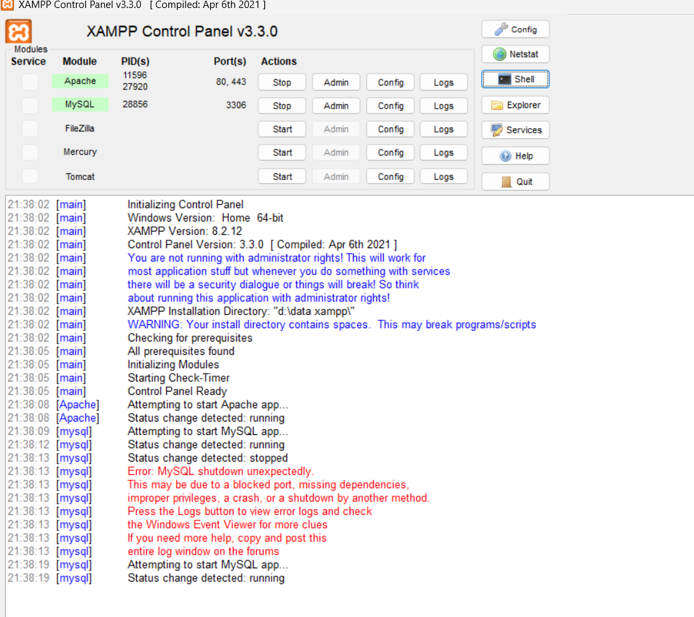

### 3.2 Masuk ke MariaDB melalui CLI

Saya masuk ke MariaDB menggunakan terminal melalui `XAMPP Shell`. Setelah prompt `MariaDB [(none)]>` muncul, berarti koneksi ke server sudah berhasil.

Saya kemudian menjalankan:

```sql
SELECT VERSION(), CURRENT_USER();
```

Hasilnya menunjukkan versi MariaDB `10.4.32-MariaDB` dan akun yang sedang digunakan sesuai tangkapan layar. Hasil ini digunakan untuk memastikan versi server dan akun yang sedang digunakan.

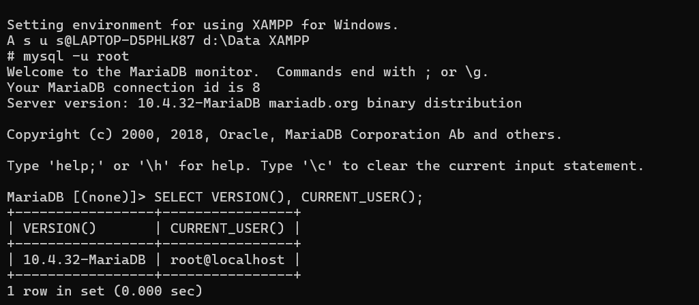

### 3.3 Memeriksa SQL Mode

Saya menjalankan:

```sql
SELECT @@sql_mode;
```

Hasil yang diperoleh adalah:

```
STRICT_TRANS_TABLES,ERROR_FOR_DIVISION_BY_ZERO,NO_AUTO_CREATE_USER,NO_ENGINE_SUBSTITUTION
```

Dari hasil tersebut terlihat bahwa `STRICT_TRANS_TABLES` aktif. Mode ini berguna untuk membuat server lebih ketat dalam menangani data yang tidak sesuai.

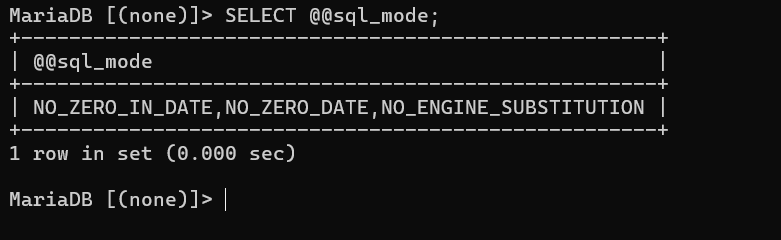

### 3.4 Membuat Basis Data Latihan dan Akun Kerja

Saya membuat basis data latihan `kopma_042` dan akun `mhs_042` untuk digunakan pada bagian latihan. Akun tersebut kemudian diberikan hak akses pada basis data `kopma_042`. Saya masuk sebagai `mhs_042` lalu memeriksa basis data yang terlihat dan hak aksesnya.

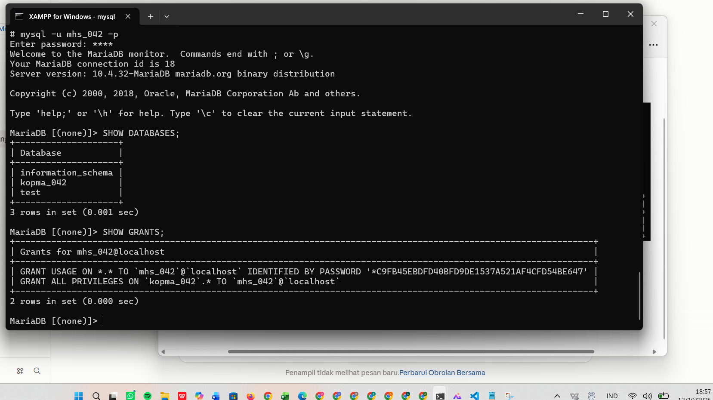

### 3.5 Membuat Basis Data Proyek

Sesuai tema proyek, saya menggunakan tema klinik. Basis data proyek yang dibuat adalah **klinik_042**, dengan:

- Character set: `utf8mb4`
- Collation: `utf8mb4_unicode_ci`

Penamaan `klinik_042` disesuaikan dengan kode tema dan tiga digit terakhir NIM saya.

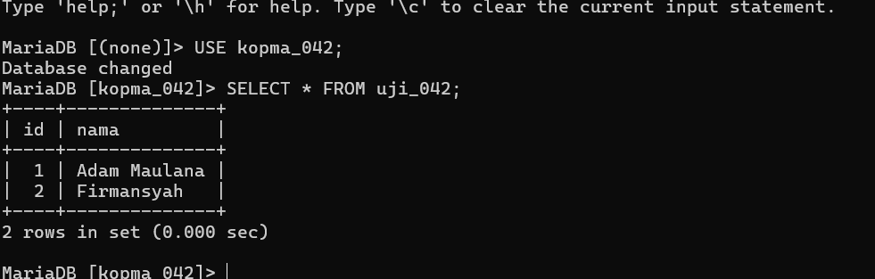

### 3.6 Membuat Akun Proyek

Akun proyek yang digunakan adalah `dev_042@localhost`. Akun ini dibuat khusus untuk kebutuhan proyek.

### 3.7 Memberikan Hak Akses

Akun `dev_042` diberikan hak akses pada basis data `klinik_042`. Saya kemudian memeriksa hak akses tersebut dengan:

```sql
SHOW GRANTS;
```

Hasilnya menunjukkan bahwa `dev_042` mempunyai hak akses penuh hanya pada `klinik_042`. Saat `SHOW DATABASES`, akun ini melihat `information_schema`, `klinik_042`, dan `test` (basis data bawaan XAMPP).

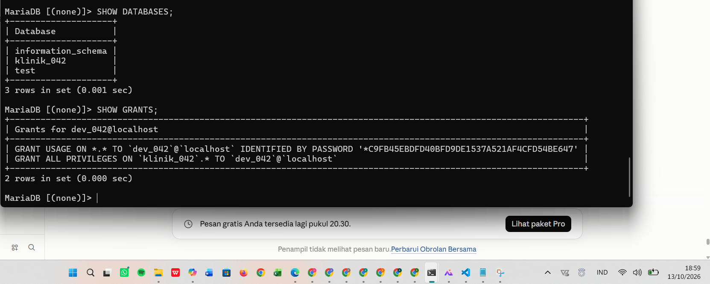

### 3.8 Menguji Batas Hak Akses

Untuk memastikan pembatasan hak akses benar-benar bekerja, saya mencoba membuka basis data latihan menggunakan akun proyek.

```sql
USE kopma_042;
```

Hasilnya `ERROR 1044`. Artinya akun `dev_042` berhasil dikenali oleh MariaDB, tetapi tidak diberikan izin untuk membuka basis data `kopma_042`.

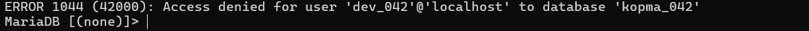

Saya juga mencoba:

```sql
SELECT * FROM mysql.user;
```

Hasilnya `ERROR 1142`. Artinya akun `dev_042` tidak memiliki izin untuk menjalankan perintah `SELECT` pada tabel `mysql.user`.


### 3.9 Pengujian Autentikasi

Saya melakukan pengujian login yang gagal, dan hasilnya `ERROR 1045`. Bagian akhir pesan menunjukkan sebabnya: `using password: NO` berarti klien tidak mengirim password, sedangkan `using password: YES` berarti password dikirim tetapi salah. Dari percobaan tersebut saya melihat bahwa `ERROR 1045` berkaitan dengan proses autentikasi atau login.

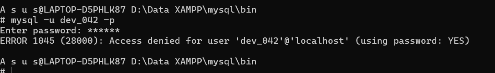

### 3.10 Konfigurasi phpMyAdmin

Pada awalnya phpMyAdmin masih menggunakan konfigurasi login otomatis. Setelah akun root diberi password, konfigurasi tersebut menyebabkan koneksi ditolak.

Saya kemudian mengubah `auth_type` pada `config.inc.php` menjadi:

```php
$cfg['Servers'][$i]['auth_type'] = 'cookie';
```

Setelah itu phpMyAdmin menampilkan halaman login sehingga username dan password dapat dimasukkan secara langsung. Saya berhasil masuk menggunakan akun `dev_042` dan dapat melihat basis data proyek `klinik_042`.

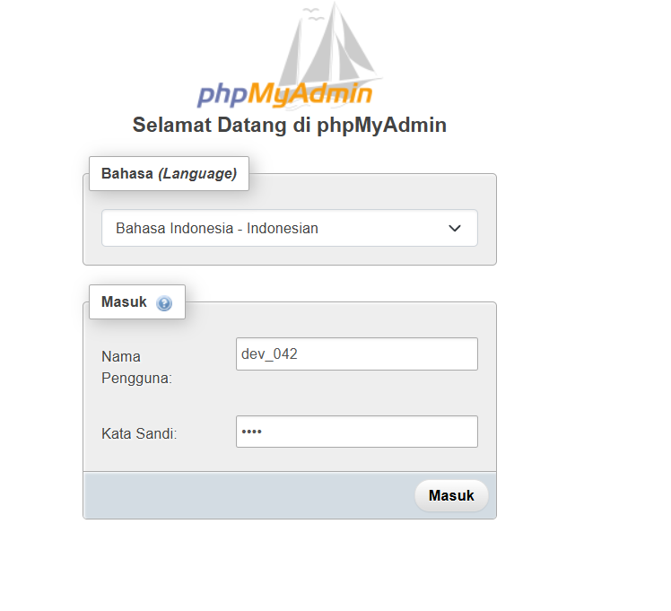

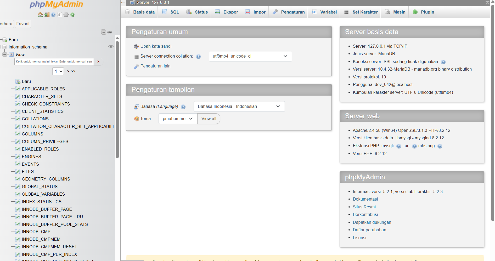

### 3.11 Menyimpan Pekerjaan ke GitHub

Repositori proyek yang digunakan adalah `https://github.com/adam25430042/basisdata-25430042`.

Berkas utama yang sudah ditambahkan:

- `.gitignore`
- `README.md`
- `p01_lingkungan_25430042.sql`
- `laporan/p01_laporan_25430042.md`
- `laporan/img/`

Commit yang dibuat pada Pertemuan 1 antara lain:

- p01: tambah gitignore
- p01: tambah skrip lingkungan
- p01: tambah bukti git push
- p01: tambah laporan praktikum
- p01: tambah folder bukti
- p01: tambah bukti show grants
- p01: tambah bukti error 1045
- p01: tambah bukti phpmyadmin dev_042
- p01: rapikan laporan
- p01: rapikan bukti laporan
- p01: milestone proyek 1

Dengan begitu, pekerjaan pada Pertemuan 1 memiliki riwayat perubahan yang jelas.

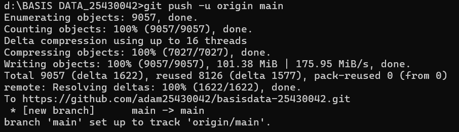

## 4. Jawaban Titik Analisis

### Titik Analisis 1

Tombol di XAMPP bertuliskan `MySQL`, tetapi server yang berjalan adalah MariaDB 10.4.32. Karena itu, jawaban di internet yang menyebut MySQL belum tentu cocok untuk server saya.

Dokumentasi MySQL masih relevan untuk hal yang sama di kedua server, misalnya sintaks SQL dasar (`SELECT`, `CREATE DATABASE`, `GRANT`) dan cara kerja client-server. Untuk hal yang bergantung pada versi atau khusus MariaDB, saya harus merujuk ke dokumentasi MariaDB, misalnya perilaku bawaan versi 10.4, pesan galat, dan fitur seperti `CREATE USER IF NOT EXISTS`. Sebelum mencoba solusi dari internet, saya memeriksa versi server dengan `SELECT VERSION()`.

### Titik Analisis 2

Setelah root diberi password, saya mencoba login tanpa memberikan password dan muncul `ERROR 1045`. Bagian pesan yang menunjukkan klien tidak mengirim password adalah `using password: NO` di akhir pesan. Jika password dikirim tetapi salah, tertulis `using password: YES`. Jadi `ERROR 1045` berhubungan dengan proses login.

Berbeda dengan `ERROR 1044`. Pada `ERROR 1044`, user sudah berhasil login tetapi mencoba membuka database yang tidak diberikan hak akses. Hal ini saya buktikan ketika akun `dev_042` mencoba membuka `kopma_042`.

Saya juga menemukan `ERROR 1142` saat akun `dev_042` mencoba menjalankan perintah pada tabel sistem yang tidak menjadi haknya. Dari percobaan tersebut saya membedakan bahwa `ERROR 1045` berkaitan dengan login, `ERROR 1044` berkaitan dengan akses ke database, sedangkan `ERROR 1142` berkaitan dengan izin menjalankan perintah pada objek atau tabel tertentu.

### Titik Analisis 3

`information_schema` tetap terlihat oleh akun kerja karena isinya hanyalah informasi tentang objek yang memang boleh dilihat oleh akun tersebut. Sebaliknya, database `mysql` berisi data akun dan hak akses sehingga tidak bisa dibuka oleh akun kerja yang tidak punya hak.

Pada percobaan saya, akun `dev_042` dapat melihat `information_schema`, `klinik_042`, dan `test` (bawaan XAMPP). Namun ketika saya mencoba `USE kopma_042`, MariaDB menampilkan `ERROR 1044` karena akun tersebut tidak diberikan akses ke database itu. `ERROR 1044` berarti login berhasil tetapi akses ke database ditolak, sedangkan `ERROR 1045` berarti login itu sendiri gagal.

### Titik Analisis 4

Mode cookie pada phpMyAdmin lebih aman dibandingkan mode `config` karena pengguna diminta mengetik username dan password pada halaman login. Pada mode `config`, password tersimpan sebagai teks biasa di berkas konfigurasi sehingga siapa pun yang dapat membuka berkas itu bisa membacanya, dan phpMyAdmin masuk otomatis tanpa verifikasi. Dengan mode cookie, password tidak perlu ditulis di konfigurasi.

## 5. Hasil Latihan dan Modifikasi

### E.1 Akun tamu_042

Saya membuat akun `tamu_042` yang hanya memiliki hak `SELECT` pada `kopma_042`, lalu masuk dengan akun tersebut.

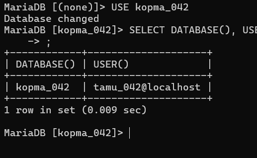

Kemudian saya mencoba membuat tabel:

```sql
CREATE TABLE uji (id INT);
```

Hasilnya `ERROR 1142`, yaitu perintah `CREATE` ditolak untuk akun `tamu_042`. Artinya akun tersebut dikenali dan bisa membaca, tetapi tidak berhak mengubah struktur basis data karena hanya diberi `SELECT`.

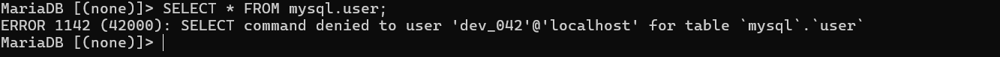

### E.2 Skrip dapat dijalankan ulang

Saya mengubah `p01_lingkungan_25430042.sql` dengan `CREATE DATABASE IF NOT EXISTS` dan `CREATE USER IF NOT EXISTS`. Skrip dijalankan dua kali:

```
mysql -u root -p < p01_lingkungan_25430042.sql
```

Kedua eksekusi selesai tanpa galat, sehingga skrip aman diulang dan tidak merusak objek yang sudah ada.

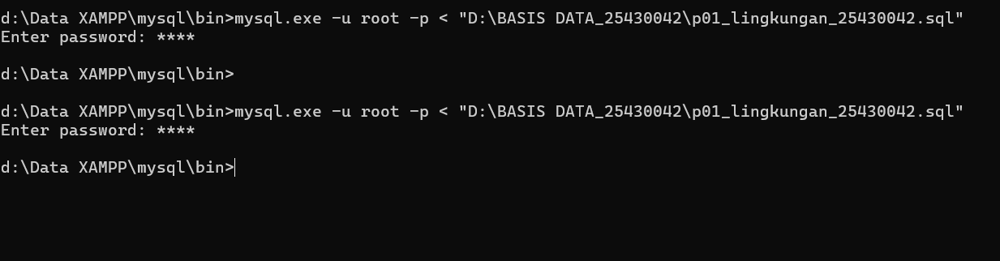

## 6. Tugas Mandiri: Milestone Proyek 1

Identitas proyek:

- Nama organisasi fiktif: `Bunda_AMF`
- Tema: Klinik
- Basis data proyek: `klinik_042`
- Akun proyek: `dev_042`

Akun `dev_042` hanya diberi hak akses pada `klinik_042`. Saya menguji dengan membuka `kopma_042` menggunakan `dev_042` dan muncul `ERROR 1044`, sehingga terbukti akun proyek tidak punya akses ke basis data latihan.

Keputusan desain: akun proyek dibatasi pada satu basis data agar kesalahan atau penyalahgunaan akun tidak memengaruhi basis data lain (prinsip least privilege). Nama organisasi memuat inisial saya (AMF) sesuai aturan keaslian. README berisi identitas proyek dan `.gitignore` mengecualikan berkas kredensial dan berkas yang tidak perlu.

Repositori proyek: `https://github.com/adam25430042/basisdata-25430042`

## 7. Pembahasan dan Kendala

**Kendala 1: `sql_mode` tidak memuat `STRICT_TRANS_TABLES`.** Penyebabnya, `sql_mode` ada dua baris di `my.ini`. Saya menambahkan tanda `#` pada salah satunya, lalu memeriksa ulang dan hasilnya sudah benar.

**Kendala 2: salah ketik pada perintah SQL.** Jika perintah salah ketik, muncul pesan seperti ini:

```
ERROR 1064 (42000): You have an error in your SQL syntax; check the manual that
corresponds to your MariaDB server version for the right syntax to use near
'CRETAE USER ...' at line 1
```

Pesan ini menunjukkan sintaks salah, dan teks setelah `near` memperlihatkan bagian yang tidak dipahami server. Cara mengatasinya adalah memperbaiki ejaan perintah, dalam kasus ini `CREATE`.

**Kendala 3: server tidak mau start dengan pesan `ibdata1 must be writable`.** Ternyata server MariaDB sudah berjalan, sehingga server kedua yang saya jalankan tidak bisa membuka berkas yang sama. Saya memeriksa dengan `tasklist` dan `netstat -ano | findstr :3306`, lalu memakai server yang sudah berjalan.

## 8. Kesimpulan

Praktikum Pertemuan 1 membantu saya menyiapkan lingkungan kerja MariaDB menggunakan XAMPP, membuat akun pengguna, membuat database proyek, dan mengatur hak akses. Saya juga berhasil membuat database `klinik_042` dan akun `dev_042`, lalu membuktikan bahwa akun tersebut tidak dapat membuka `kopma_042`. Pekerjaan praktikum sudah mulai dicatat di GitHub agar perubahan proyek dapat dilacak.

## 9. Pernyataan Penggunaan AI

Saya menggunakan AI sebagai alat bantu untuk memahami materi, menjelaskan perintah MariaDB, membaca pesan error, memahami struktur Git dan GitHub, memperbaiki kesalahan repositori, serta merapikan laporan. AI juga membantu menyusun kalimat pada bagian Tujuan Praktikum dengan izin dosen. Perintah dan hasil percobaan saya jalankan sendiri.

## 10. Bukti Git

- Repositori: `https://github.com/adam25430042/basisdata-25430042`
- Commit Pertemuan 1: `p01: milestone proyek 1`
- Hash commit: `<isi 7 karakter hash dari git log --oneline>`

Bukti commit dan isi repositori tersimpan di GitHub.

## Checklist

- [x] p01_lingkungan_25430042.sql
- [x] README.md berisi Identitas Proyek
- [x] .gitignore
- [x] SELECT VERSION(), CURRENT_USER();
- [x] SELECT @@sql_mode;
- [x] SHOW DATABASES sebagai dev_042
- [x] SHOW DATABASES sebagai mhs_042
- [x] Bukti ERROR 1044
- [x] Bukti ERROR 1142
- [x] Halaman masuk phpMyAdmin mode cookie
- [x] Git push pertama
- [x] GitHub dan commit
- [x] Titik Analisis 1 sampai 4
- [x] Analisis perbedaan ERROR 1044, 1045, dan 1142