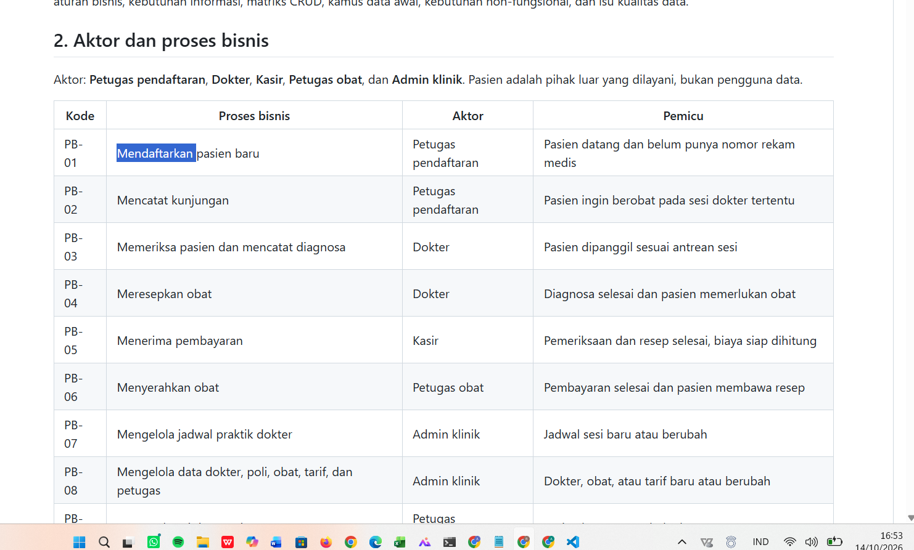
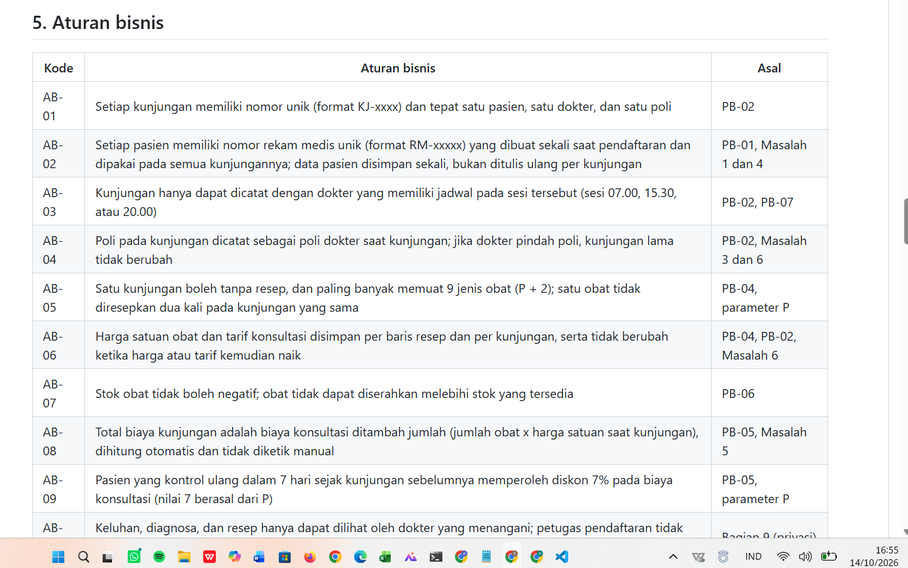
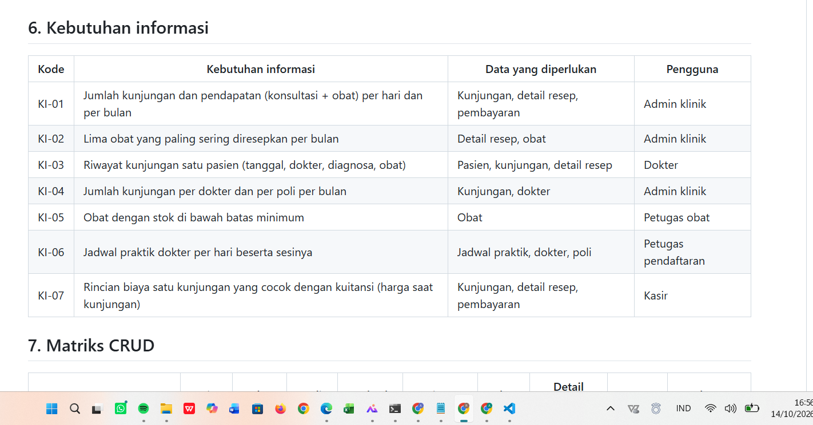
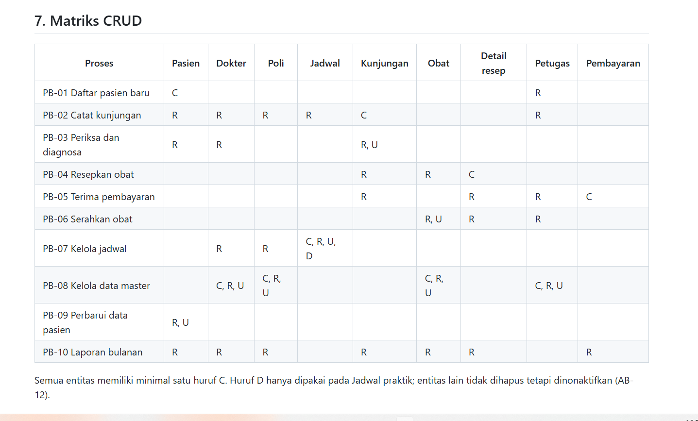
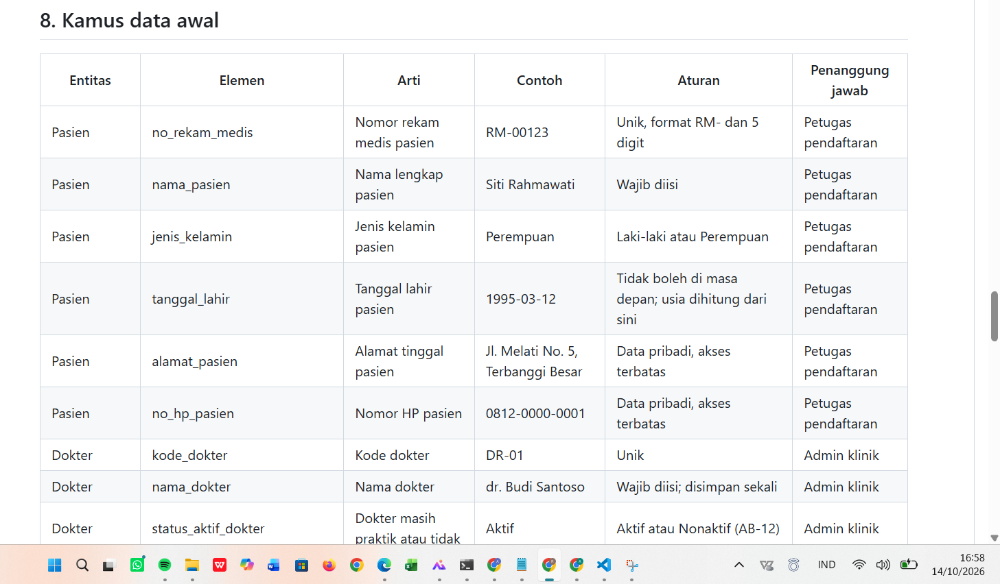

# Laporan Praktikum Basis Data - Pertemuan 02

- **Nama:** ADAM MAULANA FIRMANSYAH
- **NIM:** 25430042
- **Kelas:** B
- **Tanggal:** 7 0ktober 2026
- **Asisten/Dosen:** Dedi Irawan, S.Kom., M.T.I.

## 1. Tujuan Praktikum

Saya dapat mengenali aktor dan proses bisnis suatu organisasi, lalu membedah dokumen sumber untuk menemukan elemen data yang perlu disimpan. Saya dapat menyusun entitas kandidat, aturan bisnis, kebutuhan informasi, matriks CRUD, dan kamus data awal beserta penanggung jawabnya. Saya juga dapat mencatat kebutuhan non-fungsional, termasuk data pribadi dan pembatasan aksesnya. Seluruh hasil dituliskan dalam dokumen Markdown dan dicatat di Git yang tersambung ke GitHub.

## 2. Ringkasan Dasar Teori

Data adalah aset organisasi, sehingga setiap data perlu punya penanggung jawab. Analisis kebutuhan dimulai dari **proses bisnis**, yaitu kegiatan yang dilakukan aktor tertentu karena suatu pemicu. Dari proses itu dan dari dokumen yang dipakai sehari-hari, kita mengumpulkan **elemen data** dan mengelompokkannya menjadi **entitas kandidat**, yaitu benda atau kejadian yang dicatat, bukan tindakan.

**Aturan bisnis** adalah ketentuan yang harus dipatuhi data, misalnya nilai yang tidak boleh negatif atau harga yang harus tetap seperti saat transaksi. **Kebutuhan informasi** adalah pertanyaan yang harus bisa dijawab oleh data. **Matriks CRUD** memperlihatkan proses mana yang membuat (Create), membaca (Read), mengubah (Update), dan menghapus (Delete) entitas mana, sehingga entitas yang tidak pernah dibuat atau proses yang tidak menyentuh data dapat terlihat. **Kamus data** mencatat arti, contoh, aturan, dan penanggung jawab tiap elemen.

Nilai yang dapat dihitung dari elemen lain disebut **nilai turunan**. Data kesehatan dan identitas pasien termasuk data pribadi, dan pembatasan aksesnya sejalan dengan kewajiban pengendali data dalam Undang-Undang Pelindungan Data Pribadi.

## 3. Hasil Langkah Percobaan

### 3.1 Menyiapkan berkas

Modul ini tidak memerlukan basis data, sehingga seluruh pekerjaan dilakukan di VS Code dan Git. Di repositori `basisdata-25430042` saya membuat dua berkas: `p02_kebutuhan_data_kopma_25430042.md` untuk latihan Kopma dan `p02_kebutuhan_data_25430042.md` untuk proyek klinik. Keduanya memakai kerangka 10 bagian dari buku praktikum.

### 3.2 Aktor dan proses bisnis Kopma

Dari narasi Kopma saya menemukan lima proses: mendaftarkan anggota, mencatat penjualan, memesan barang ke pemasok, menerima barang dari pemasok, dan menyusun laporan bulanan. Tiap proses dicatat dengan aktor dan pemicunya.

### 3.3 Membedah nota penjualan

Nota dibedah per isian menjadi 11 elemen. Subtotal, diskon, dan total adalah nilai turunan, sedangkan harga satuan saat transaksi harus disimpan per baris nota.

### 3.4 Entitas kandidat dan aturan bisnis

Elemen dikelompokkan menjadi tujuh entitas kandidat (anggota, barang, penjualan, detail penjualan, petugas, pemasok, dan pembelian). Saya menulis enam aturan bisnis; aturan yang paling penting adalah AB-04, yaitu harga pada nota tidak berubah meski harga barang kemudian naik.

### 3.5 Kebutuhan informasi dan matriks CRUD

Ada empat kebutuhan informasi untuk ketua koperasi (omzet, barang terlaris, stok menipis, dan anggota paling aktif). Pada matriks CRUD saya menemukan bahwa kolom Pemasok tidak pernah mendapat huruf C (dibahas pada Titik Analisis 3).

### 3.6 Kamus data dan kebutuhan non-fungsional

Kamus data awal Kopma memuat enam elemen contoh dengan penanggung jawab. Kebutuhan non-fungsionalnya: sekitar 150 nota per hari, data disimpan minimal lima tahun, dan nomor HP anggota hanya boleh dilihat oleh ketua.

### 3.7 Menulis dokumen dan commit

Hasil langkah D.2 sampai D.6 dipindahkan ke `p02_kebutuhan_data_kopma_25430042.md`, lalu di-commit dengan pesan `p02: dokumen kebutuhan data kopma` (hash `947be71`).

## 4. Jawaban Titik Analisis

### Titik Analisis 1

Harga di data barang dapat berubah kapan saja. Kalau nota hanya menunjuk ke data barang, harga pada nota lama ikut berubah ketika harga naik, sehingga nota lama tidak lagi cocok dengan uang yang pernah diterima. Itu persis keluhan ketua koperasi pada kutipan wawancara: harga di nota lama tidak bisa dicek lagi. Karena itu nota menyimpan harga saat transaksi pada setiap barisnya (AB-04), supaya nota lama tetap menampilkan harga yang berlaku waktu itu.

### Titik Analisis 2

Alasan tidak menyimpan subtotal dan total: nilainya dapat dihitung ulang dari qty, harga satuan, dan diskon, sehingga tidak ada risiko angka yang tersimpan tidak cocok jika qty atau harga dikoreksi. Alasan total mungkin tetap disimpan: laporan omzet menjadi lebih cepat karena tidak perlu menghitung ulang banyak baris, dan total nota lama tidak berubah meskipun aturan diskon diubah di masa depan. Keputusan akhirnya dibahas di Modul 4.

### Titik Analisis 3

Kolom Pemasok tidak memiliki huruf C pada matriks CRUD. Artinya tidak ada proses yang membuat data pemasok, sehingga entitas itu tidak pernah terisi dan pembelian tidak dapat merujuk ke pemasok. Daftar proses bisnis perlu ditambah dengan proses **mengelola data pemasok** (aktor petugas gudang, pemicunya pemasok baru atau data pemasok berubah) dengan akses C, R, dan U pada Pemasok.

Status aktif anggota juga belum diubah oleh proses mana pun; hanya pendaftaran yang membuat data anggota. Perlu proses **mengelola status anggota** yang dilakukan ketua koperasi saat anggota berhenti atau mendaftar ulang, dengan akses R dan U pada Anggota.

## 5. Hasil Latihan dan Modifikasi

### E.1 Poin loyalitas Kopma

Kopma memberi satu poin untuk setiap kelipatan Rp10.000 belanja anggota, dan 50 poin dapat ditukar dengan potongan Rp5.000.

**Elemen data baru:**

| Elemen | Arti | Contoh | Catatan |
|---|---|---|---|
| poin_didapat | Poin yang diperoleh pada satu nota | 3 | Disimpan per nota |
| poin_ditukar | Poin yang dipakai pada satu nota | 50 | Disimpan per nota |
| potongan_poin | Potongan harga dari penukaran poin | 5000 | Turunan: (poin ditukar / 50) x Rp5.000 |
| saldo_poin_anggota | Sisa poin milik anggota | 12 | Turunan dari jumlah poin didapat dikurangi poin ditukar; keputusan disimpan atau tidak dibahas di Modul 4 |

**Aturan bisnis tambahan:**

| Kode | Aturan bisnis |
|---|---|
| AB-07 | Setiap kelipatan Rp10.000 dari total belanja anggota pada satu nota bernilai 1 poin, dibulatkan ke bawah (total Rp37.500 menghasilkan 3 poin). |
| AB-08 | Penukaran poin hanya dalam kelipatan 50 poin, dan setiap 50 poin bernilai potongan Rp5.000. |
| AB-09 | Poin hanya diberikan kepada anggota yang berstatus aktif; pembeli umum tidak memperoleh poin. |
| AB-10 | Saldo poin anggota tidak boleh negatif, sehingga poin yang ditukar tidak boleh melebihi saldo. |
| AB-11 | Poin yang didapat dan ditukar dicatat per nota dan tidak berubah setelah nota dibuat. |

**Kebutuhan informasi baru:**

| Kode | Kebutuhan informasi | Data yang diperlukan |
|---|---|---|
| KI-05 | Saldo poin setiap anggota dan jumlah poin yang ditukar per bulan | Anggota, penjualan |

**Pembaruan matriks CRUD:** proses PB-02 (mencatat penjualan) kini juga membaca saldo poin anggota dan membuat catatan poin pada nota (C pada Penjualan). Jika saldo poin disimpan pada anggota, PB-02 juga mengubahnya (U pada Anggota); jika saldo dihitung dari catatan poin, akses U pada Anggota tidak diperlukan.

### E.2 Memperbaiki tiga pernyataan kebutuhan kabur

| Pernyataan awal | Pernyataan hasil perbaikan | Cara menguji |
|---|---|---|
| (a) Data anggota harus aman | Nomor HP dan NIM anggota hanya dapat dilihat oleh ketua koperasi; akun kasir tidak dapat membaca kolom `no_hp_anggota` dan `nim_anggota`. | Masuk sebagai kasir dan coba membaca kolom itu: harus ditolak |
| (b) Sistem harus cepat mencari barang | Pencarian barang berdasarkan kode atau nama pada sekitar 1.000 jenis barang menampilkan hasil dalam waktu paling lama 2 detik. | Ukur waktu 20 pencarian: seluruhnya tidak lebih dari 2 detik |
| (c) Laporan stok harus akurat | Stok pada laporan sama dengan stok awal ditambah qty penerimaan dikurangi qty penjualan, dan tidak pernah negatif. | Bandingkan laporan dengan hitung fisik awal bulan: tidak ada selisih |

Angka 1.000 jenis barang dan 2 detik adalah asumsi saya untuk Kopma, yang dapat disesuaikan.

## 6. Tugas Mandiri: Milestone Proyek 2

- **Organisasi fiktif:** Bunda_AMF
- **Tema:** Klinik
- **Berkas:** `p02_kebutuhan_data_25430042.md`
- **Dokumen sumber:** Lembar Kunjungan Pasien (dibedah menjadi 22 elemen) dan jadwal praktik dokter

**Isi dokumen proyek dibandingkan dengan ketentuan minimum:**

| Komponen | Minimum | Pada dokumen saya |
|---|---|---|
| Proses bisnis | 4 | 10 |
| Entitas kandidat | 6 | 9 |
| Aturan bisnis | 8 | 12 |
| Kebutuhan informasi | 5 | 7 |
| Matriks CRUD | Tanpa entitas tanpa C | Semua 9 entitas memiliki C |
| Kamus data | 20 elemen dengan penanggung jawab | 37 elemen |
| Non-fungsional | Data pribadi dan akses | Ada, termasuk tabel hak akses per peran |

**Perhitungan parameter P.** NIM saya 25430042, dua digit terakhirnya 42. 42 mod 9 = 6, sehingga **P = 6 + 1 = 7**.

| Parameter | Rumus | Hasil | Dipakai pada |
|---|---|---|---|
| Batas maksimal item per transaksi | P + 2 | 9 | AB-05: paling banyak 9 jenis obat per kunjungan |
| Persentase diskon | P | 7% | AB-09: diskon konsultasi kontrol ulang dalam 7 hari |
| Perkiraan volume transaksi harian | 40 + 5 x P | 75 | Sekitar 75 kunjungan per hari |

**Keputusan desain yang penting.** Harga obat dan tarif konsultasi disimpan per baris resep dan per kunjungan (AB-06), karena lembar kunjungan lama harus tetap cocok dengan kuitansi pasien (Masalah 6 pada dokumen sumber). Keluhan, diagnosa, dan resep ditandai sebagai data kesehatan spesifik dan hanya dapat dilihat oleh dokter yang menangani (AB-10). Setiap aturan bisnis saya hubungkan dengan proses atau masalah asalnya pada kolom "Asal".

## 7. Pembahasan dan Kendala

**Kendala 1: nama berkas bertambah ` (1)` saat diunduh.** Berkas `p02_kebutuhan_data_25430042 (1).md` tidak sesuai dengan nama yang diminta buku. Saya mengganti namanya lewat File Explorer dengan menghapus ` (1)`, lalu memeriksanya dengan `dir p02*` dan `git status`.

**Kendala 2: kedua dokumen ter-commit sekaligus dengan satu pesan.** Dokumen Kopma ikut ter-commit bersama dokumen proyek pada commit `p02: dokumen kebutuhan data proyek`, padahal buku meminta commit khusus Kopma dengan pesan `p02: dokumen kebutuhan data kopma`. Saya tidak mengubah riwayat yang sudah di-push, tetapi menambahkan satu kalimat sumber pada dokumen Kopma dan men-commit-nya dengan pesan yang benar.

**Kendala 3: perintah Git salah ketik.** Perintah `gith push` tidak dikenali sehingga commit belum terkirim ke GitHub. `git log` memperlihatkan `origin/main` masih tertinggal, lalu saya menjalankan `git push` dengan benar.

**Kendala 4: MariaDB tidak mau menyala.** Saat Start di XAMPP, MariaDB berhenti sendiri karena log Aria rusak (`Aria recovery failed`) akibat penghentian yang tidak sempurna. Modul ini tidak memakai basis data sehingga pengerjaan dokumen tidak terganggu, dan pemulihannya dikerjakan terpisah.

## 8. Kesimpulan

Praktikum Pertemuan 2 melatih saya menganalisis kebutuhan data sebelum merancang basis data. Dari proses bisnis dan dokumen sumber saya dapat menyusun entitas kandidat, aturan bisnis, kebutuhan informasi, matriks CRUD, dan kamus data. Saya juga memahami bahwa harga historis harus disimpan per transaksi dan bahwa data kesehatan perlu pembatasan akses. Seluruh hasil tercatat di GitHub dengan commit berformat `p02:`.

## 9. Pernyataan Penggunaan AI

Saya menggunakan AI sebagai alat bantu untuk memahami materi analisis kebutuhan data, membantu menyusun draf dokumen kebutuhan data (proses bisnis, aturan bisnis, entitas, matriks CRUD, dan kamus data), merapikan dokumen sumber fiktif, serta membantu memperbaiki kesalahan perintah Git. Bantuan ini saya gunakan dengan izin dosen yang saya konfirmasi saat pembelajaran. Hasilnya saya baca, saya setujui, dan saya pelajari sehingga saya dapat menjelaskan asal setiap aturan dari proses bisnisnya.

## 10. Bukti Git

- Repositori: `https://github.com/adam25430042/basisdata-25430042`
- Commit dokumen Kopma dan proyek: `38d9866` (`p02: dokumen kebutuhan data proyek`)
- Commit dokumen Kopma: `947be71` (`p02: dokumen kebutuhan data kopma`)
- Commit laporan: `<isi 7 karakter hash setelah commit laporan>`

## Checklist

- [x] p02_kebutuhan_data_kopma_25430042.md
- [x] p02_kebutuhan_data_25430042.md (proyek)
- [ ] Bukti tangkapan layar tampilan GitHub (tabel PB, AB, KI, CRUD, kamus data)
- [x] Titik Analisis 1 sampai 3
- [x] Perhitungan parameter P
- [x] Perbaikan tiga pernyataan kebutuhan kabur
- [x] Commit berformat `p02:`
