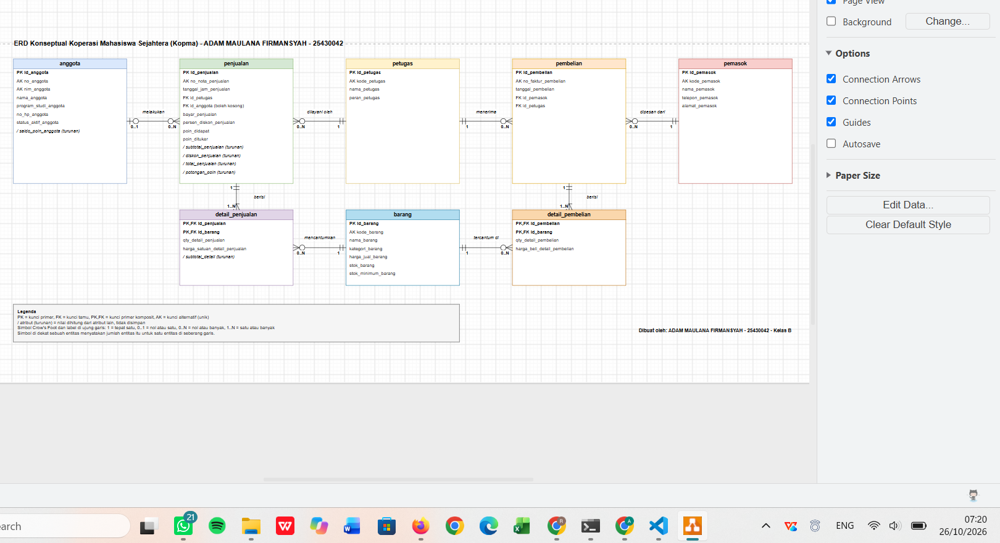
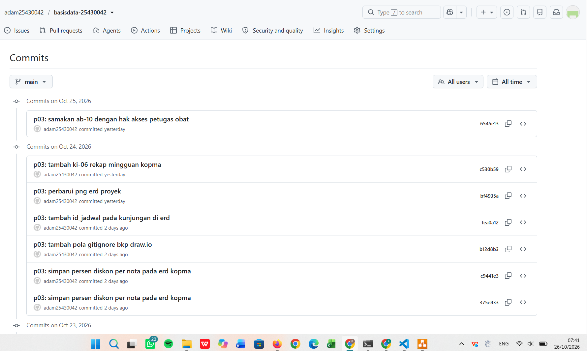
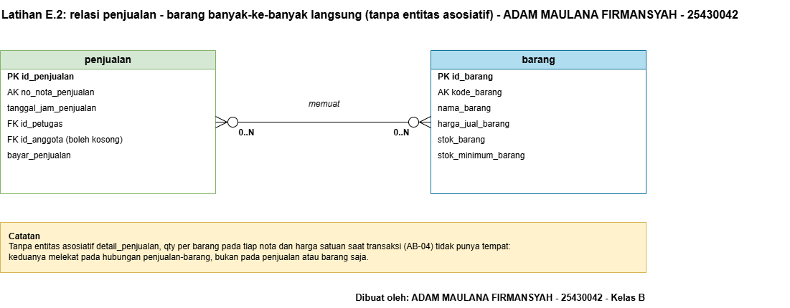
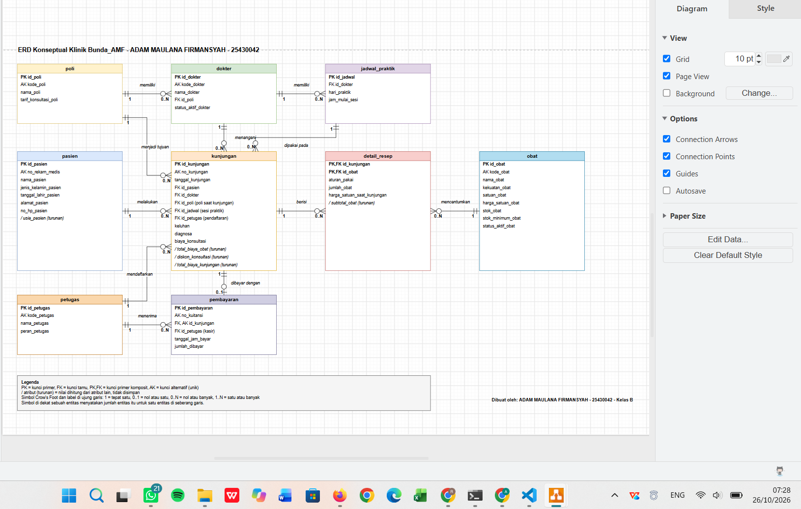

# Laporan Praktikum Basis Data - Pertemuan 03

- **Nama:** ADAM MAULANA FIRMANSYAH
- **NIM:** 25430042
- **Kelas:** B
- **Tanggal:** 25 Oktober 2026
- **Asisten/Dosen:** Dedi Irawan, S.Kom., M.T.I.

## 1. Tujuan Praktikum

Saya dapat mengubah dokumen kebutuhan data menjadi model konseptual berupa ERD. Saya dapat menentukan entitas, atribut, kunci primer, kunci tamu, dan kunci alternatif, lalu menetapkan relasi beserta kardinalitasnya berdasarkan aturan bisnis. Saya dapat menggambar ERD dengan notasi Crow's Foot di draw.io, menelusuri setiap kebutuhan informasi pada ERD, dan menerima umpan balik klien. Hasilnya saya simpan di Git yang tersambung ke GitHub.

## 2. Ringkasan Dasar Teori

ERD konseptual menggambarkan entitas, atribut, dan relasi tanpa membahas tipe data atau constraint, yang baru ditetapkan di Modul 5. **Kunci primer** (PK) mengenali satu baris secara unik, **kunci tamu** (FK) merujuk kunci primer entitas lain, dan **kunci alternatif** (AK) adalah atribut unik lain yang tidak dipilih sebagai kunci primer. **Kunci komposit** terdiri dari beberapa atribut, misalnya pada entitas asosiatif.

Kardinalitas menyatakan jumlah minimum dan maksimum pada tiap sisi relasi: 1 (tepat satu), 0..1 (nol atau satu), 0..N (nol atau banyak), dan 1..N (satu atau banyak). Simbol di dekat sebuah entitas menyatakan jumlah entitas itu untuk satu entitas di seberang garis. Relasi banyak-ke-banyak dipecah menjadi **entitas asosiatif** yang memiliki atribut sendiri, misalnya `detail_penjualan` dengan qty dan harga saat transaksi. **Atribut turunan** adalah nilai yang dapat dihitung dari atribut lain; ia tetap digambar tetapi ditandai khusus, dan keputusan menyimpan atau menghitungnya dibahas di Modul 4.

## 3. Hasil Langkah Percobaan

### 3.1 Menetapkan entitas, atribut, dan kunci Kopma

Dari dokumen kebutuhan data Pertemuan 2 saya memecah entitas "pembelian dan detailnya" menjadi `pembelian` dan `detail_pembelian`, sehingga Kopma memiliki delapan entitas: `anggota`, `barang`, `petugas`, `pemasok`, `penjualan`, `detail_penjualan`, `pembelian`, dan `detail_pembelian`. Tiap entitas diberi `id_...` sebagai kunci primer, sedangkan kode atau nomor yang unik (misalnya `no_anggota`, `nim_anggota`, `no_nota_penjualan`) dijadikan kunci alternatif. Subtotal, diskon, total, potongan poin, dan saldo poin ditandai sebagai atribut turunan. Persentase diskon yang berlaku saat nota dibuat disimpan sebagai atribut `persen_diskon_penjualan` pada `penjualan` (AB-13).

### 3.2 Relasi dan kardinalitas Kopma

| Relasi | Sisi kiri | Sisi kanan | Dasar |
|---|---|---|---|
| petugas melayani penjualan | tepat satu petugas | nol atau banyak penjualan | wawancara kasir |
| anggota melakukan penjualan | nol atau satu anggota | nol atau banyak penjualan | AB-02 |
| penjualan berisi detail_penjualan | tepat satu penjualan | satu atau banyak detail | AB-01 |
| barang tercantum di detail_penjualan | tepat satu barang | nol atau banyak detail | AB-04 |
| pemasok menerima pembelian | tepat satu pemasok | nol atau banyak pembelian | AB-06 |
| pembelian berisi detail_pembelian | tepat satu pembelian | satu atau banyak detail | faktur pemasok |
| petugas menerima pembelian | tepat satu petugas | nol atau banyak pembelian | AB-12 |
| barang tercantum di detail_pembelian | tepat satu barang | nol atau banyak detail | faktur pemasok |

### 3.3 Menggambar ERD Kopma

ERD digambar di draw.io dengan satu warna per entitas, atribut lengkap sesuai kamus data, label PK, FK, PK,FK, dan AK, simbol Crow's Foot dengan label angka di kedua ujung garis, kata kerja pada tiap garis, kotak legenda, serta tanda tangan nama dan NIM di sudut kanan bawah. Hasilnya disimpan sebagai `p03_erd_kopma_25430042.drawio` dan `p03_erd_kopma_25430042.png`.

Gambar 1. ERD Kopma dengan delapan entitas, delapan relasi, legenda, dan tanda tangan.

### 3.4 Menelusuri kebutuhan informasi pada ERD Kopma

| KI | Kebutuhan informasi | Jalur di ERD |
|---|---|---|
| KI-01 | Omzet dan jumlah nota per hari dan bulan | penjualan, detail_penjualan |
| KI-02 | Lima barang terlaris per bulan | detail_penjualan, barang |
| KI-03 | Barang dengan stok di bawah batas minimum | barang |
| KI-04 | Sepuluh anggota dengan belanja terbesar | anggota, penjualan, detail_penjualan |
| KI-05 | Saldo poin dan poin ditukar per bulan | anggota, penjualan |
| KI-06 | Rekap omzet dan jumlah nota per minggu | penjualan, detail_penjualan |

Seluruh enam KI dapat ditelusuri, sehingga ERD tidak kekurangan entitas, atribut, atau relasi.

### 3.5 Tinjauan klien

| No | Sumber | ERD | Umpan balik | Keputusan | Alasan |
|---|---|---|---|---|---|
| 1 | Dito, 23 Oktober 2026 | Kopma | Tambahkan rekap mingguan pada aktor dan proses bisnis agar data lebih mudah dicek. | Diterima sebagian | Kebutuhan mingguan dimasukkan sebagai KI-06, tetapi tidak ada proses bisnis baru karena PB-05 (laporan) tetap bulanan. Rekap mingguan dapat dihitung dari tanggal_jam_penjualan sehingga ERD tidak berubah. |
| 2 | Saran tambahan dari AI | Kopma | Persentase diskon dihitung dari aturan yang berlaku, sehingga nota lama bisa ikut berubah. | Diterima | Persentase diskon saat nota dibuat disimpan per nota (AB-13), seperti harga per baris (AB-04). |
| 3 | Andi, 24 Oktober 2026 | Klinik | Seharusnya tidak usah menyertakan nama atribut resep obat. | Ditolak | Resep dibutuhkan agar pasien tahu aturan obat yang harus diminum. Satu kunjungan bisa punya banyak obat, sehingga resep dipisah ke detail_resep, dan harga per baris dibutuhkan agar kuitansi lama tidak berubah (AB-06). |
| 4 | Andi, 24 Oktober 2026 | Klinik | Samakan AB-10 dengan bagian 9 dan matriks CRUD: petugas obat boleh melihat obat, jumlah, dan aturan pakai. | Diterima | Petugas obat tidak bisa menyerahkan obat tanpa membaca resep. Aturan yang bertentangan akan menghasilkan hak akses yang salah. AB-10, tabel hak akses (bagian 9), dan kamus data (aturan_pakai) diperbarui. |
| 5 | Saran tambahan dari AI | Klinik | Kunjungan tidak mencatat sesi praktik, sehingga AB-03 tidak dapat diperiksa. | Diterima | Ditambahkan id_jadwal pada kunjungan dan AB-13 agar dokter pada kunjungan sama dengan dokter pada jadwal. |

Baris 1, 3, dan 4 adalah ucapan teman sekelas, sedangkan baris 2 dan 5 adalah saran tambahan dari AI yang saya pertimbangkan dan putuskan sendiri.

### 3.6 Menyimpan ke GitHub

Hasil disimpan dengan pesan commit berformat `p03:`:

- `520479e` `p03: erd kopma`
- `375e833` dan `c9441e3` `p03: simpan persen diskon per nota pada erd kopma`
- `c530b59` `p03: tambah ki-06 rekap mingguan kopma`
- `6545e13` `p03: samakan ab-10 dengan hak akses petugas obat`

Gambar 2. Riwayat commit Pertemuan 3 di GitHub.

## 4. Jawaban Titik Analisis

### Titik Analisis 1

`no_anggota` dan `nim_anggota` memang sama-sama unik, tetapi keduanya dijadikan kunci alternatif, sedangkan kunci primernya adalah `id_anggota`. Alasannya, kunci primer dirujuk sebagai kunci tamu oleh tabel lain, sehingga nilainya sebaiknya tidak pernah berubah. Risiko jika NIM dijadikan kunci primer: NIM dapat salah ketik atau berubah (misalnya koreksi data), sehingga perubahannya harus merembet ke semua tabel yang merujuknya. NIM juga data pribadi, jadi tidak ideal tersebar sebagai kunci tamu di banyak tabel.

### Titik Analisis 2

Sisi `penjualan` terhadap `detail_penjualan` bernilai satu atau banyak karena aturan **AB-01**: setiap nota memiliki minimal satu baris barang. Struktur tabel saja tidak dapat menjaga aturan "minimal satu" ini. Kunci tamu hanya memastikan bahwa setiap baris detail merujuk sebuah penjualan yang ada, tetapi tidak dapat memaksa sebuah penjualan memiliki setidaknya satu detail. Karena itu aturan ini perlu dijaga lewat transaksi, yang dibahas di Modul 14.

### Titik Analisis 3

ERD sebelumnya belum dapat menjawab "petugas gudang mana yang menerima barang dari pemasok", karena `pembelian` hanya berhubungan dengan `pemasok` dan tidak dengan `petugas`. Perlu ditambahkan relasi **petugas menerima pembelian** (tepat satu petugas untuk setiap pembelian, dan satu petugas dapat menerima nol atau banyak pembelian), yang menambah atribut `id_petugas` sebagai kunci tamu di `pembelian`. Keputusan ini dicatat sebagai aturan bisnis baru **AB-12** pada dokumen kebutuhan data Kopma.

## 5. Hasil Latihan dan Modifikasi

### E.1 Poin loyalitas pada ERD Kopma

Poin loyalitas dicatat sebagai atribut pada `penjualan` (`poin_didapat` dan `poin_ditukar` per nota), sedangkan saldo poin anggota ditandai sebagai **atribut turunan** pada `anggota`. Saya tidak membuat entitas riwayat poin karena setiap perubahan poin sudah tercatat per nota pada `penjualan`, sehingga saldo dapat dihitung dari jumlah poin didapat dikurangi poin ditukar. Berbeda dengan persentase diskon, nilai poin sudah tersimpan per nota, sehingga nota lama tidak berubah bila aturan "Rp10.000 = 1 poin" diubah. Entitas riwayat poin baru diperlukan jika poin dapat berubah di luar penjualan, misalnya koreksi manual, poin kedaluwarsa, atau bonus pendaftaran. Keputusan akhir menyimpan atau menghitung saldo dibahas di Modul 4.

### E.2 Relasi penjualan-barang sebagai banyak-ke-banyak langsung

Jika `penjualan` dan `barang` digambar berhubungan banyak-ke-banyak secara langsung (tanpa `detail_penjualan`), data yang hilang adalah atribut yang melekat pada hubungannya, bukan pada salah satu entitas: **jumlah barang (qty) pada tiap nota** dan **harga satuan saat transaksi** (AB-04). Nilai itu tidak dapat disimpan di `penjualan` (karena satu nota memuat banyak barang) maupun di `barang` (karena satu barang muncul di banyak nota). Karena itu relasi tersebut harus dipecah dengan entitas asosiatif `detail_penjualan`.

Gambar 3. Relasi penjualan-barang sebagai banyak-ke-banyak langsung (tanpa entitas asosiatif).

## 6. Tugas Mandiri: Milestone Proyek 3

- **Organisasi fiktif:** Bunda_AMF
- **Tema:** Klinik
- **Berkas:** `p03_erd_25430042.drawio` dan `p03_erd_25430042.png`
- **Sumber:** dokumen kebutuhan data Pertemuan 2 (`p02_kebutuhan_data_25430042.md`)

### 6.1 Entitas dan kunci

ERD klinik memiliki sembilan entitas: `poli`, `dokter`, `jadwal_praktik`, `pasien`, `kunjungan`, `detail_resep`, `obat`, `petugas`, dan `pembayaran`. Entitas asosiatif dengan atribut sendiri adalah `detail_resep` (atribut `aturan_pakai`, `jumlah_obat`, `harga_satuan_saat_kunjungan`, dan turunan `subtotal_obat`), dengan kunci primer komposit `id_kunjungan` dan `id_obat`.

### 6.2 Relasi dan kardinalitas klinik

| Relasi | Sisi kiri | Sisi kanan | Dasar |
|---|---|---|---|
| poli memiliki dokter | tepat satu poli | nol atau banyak dokter | Masalah 3 pada dokumen sumber |
| dokter memiliki jadwal_praktik | tepat satu dokter | nol atau banyak jadwal | AB-03 |
| dokter menangani kunjungan | tepat satu dokter | nol atau banyak kunjungan | AB-01 |
| pasien melakukan kunjungan | tepat satu pasien | nol atau banyak kunjungan | AB-01, AB-02 |
| poli menjadi tujuan kunjungan | tepat satu poli | nol atau banyak kunjungan | AB-04 |
| petugas mendaftarkan kunjungan | tepat satu petugas | nol atau banyak kunjungan | PB-02 |
| jadwal_praktik dipakai pada kunjungan | tepat satu jadwal | nol atau banyak kunjungan | AB-03, AB-13 |
| kunjungan berisi detail_resep | tepat satu kunjungan | nol atau banyak detail | AB-05 |
| obat tercantum di detail_resep | tepat satu obat | nol atau banyak detail | AB-06 |
| kunjungan dibayar dengan pembayaran | tepat satu kunjungan | nol atau satu pembayaran | AB-11 |
| petugas (kasir) menerima pembayaran | tepat satu petugas | nol atau banyak pembayaran | AB-11 |

### 6.3 Gambar ERD klinik

Gambar 4. ERD klinik Bunda_AMF dengan sembilan entitas dan sebelas relasi.

### 6.4 Menelusuri kebutuhan informasi klinik

| KI | Kebutuhan informasi | Jalur di ERD |
|---|---|---|
| KI-01 | Jumlah kunjungan dan pendapatan per hari dan bulan | kunjungan, detail_resep, pembayaran |
| KI-02 | Lima obat yang paling sering diresepkan | detail_resep, obat |
| KI-03 | Riwayat kunjungan satu pasien | pasien, kunjungan, dokter, detail_resep, obat |
| KI-04 | Kunjungan per dokter dan per poli per bulan | dokter, kunjungan, poli |
| KI-05 | Obat dengan stok di bawah batas minimum | obat |
| KI-06 | Jadwal praktik dokter per hari | jadwal_praktik, dokter, poli |
| KI-07 | Rincian biaya satu kunjungan sesuai kuitansi | kunjungan, detail_resep, pembayaran |
| KI-08 | Jumlah kunjungan per sesi praktik per bulan | kunjungan, jadwal_praktik |

Seluruh delapan KI dapat ditelusuri pada ERD.

### 6.5 Keputusan desain

- `kunjungan` menyimpan `id_poli` sendiri (poli saat kunjungan) walaupun dokter sudah memiliki poli, agar riwayat kunjungan lama tidak berubah ketika dokter pindah poli (AB-04).
- Harga obat dan tarif konsultasi disimpan pada `detail_resep` dan `kunjungan` agar kuitansi lama tetap cocok (AB-06).
- Total biaya obat, diskon konsultasi, dan total biaya kunjungan ditandai sebagai atribut turunan.
- `kunjungan` mencatat `id_jadwal` agar sesi praktik tempat kunjungan terjadi diketahui, sehingga AB-03 dapat diperiksa dan KI-08 dapat dijawab. Aturan **AB-13** mewajibkan dokter pada kunjungan sama dengan dokter pada jadwal itu. Keberadaan `id_dokter` bersama `id_jadwal` adalah redundansi yang saya ketahui dan akan saya tinjau kembali saat normalisasi di Modul 4.
- Aturan AB-03 (dokter hanya dipilih bila punya jadwal pada sesi itu) dan batas 9 jenis obat per kunjungan (AB-05) tidak dapat dijaga oleh garis relasi saja, dan dibahas di modul berikutnya.
- Perubahan yang saya putuskan sendiri setelah meninjau umpan balik: menyimpan persentase diskon per nota pada ERD Kopma (agar nota lama tetap sama) dan menambahkan `id_jadwal` pada `kunjungan` pada ERD klinik. Keduanya saya perbarui juga pada dokumen kebutuhan data Pertemuan 2.

### 6.6 Tinjauan klien

Tinjauan klien untuk kedua ERD dicatat pada tabel di bagian 3.5. Untuk ERD klinik, umpan balik Andi tentang atribut resep ditolak karena resep dibutuhkan pasien dan harga per baris diperlukan untuk kuitansi (AB-06). Umpan balik Andi tentang AB-10 diterima: petugas obat harus dapat membaca nama obat, jumlah, dan aturan pakai agar dapat menyerahkan obat, sehingga AB-10, tabel hak akses, dan kamus data pada dokumen klinik disamakan. Saran tambahan `id_jadwal` juga diterima dan sudah diterapkan.

## 7. Pembahasan dan Kendala

**Kendala 1: draw.io menolak berkas.** Saat membuka `p03_erd_kopma_25430042.drawio`, draw.io menampilkan pesan `Bukan berkas diagram (error on line 2 at column 1: Start tag expected, '<' not found)`. Setelah saya periksa dengan PowerShell, isi berkas ternyata teks dari jendela MariaDB, bukan XML diagram. Pesan galat itu berarti draw.io membaca teks yang bukan XML. Saya menghapus berkas itu, mengunduh ulang berkas yang benar, lalu memeriksa ukurannya (29.070 byte) dan awal isinya (`<mxfile`).

**Kendala 2: nama PNG hasil ekspor tidak sesuai.** draw.io menyimpan gambar sebagai `p03_erd_kopma_25430042.drawio.png`. Saya mengganti namanya menjadi `p03_erd_kopma_25430042.png` dengan perintah `ren`, dan untuk ekspor berikutnya saya mematikan opsi menyertakan salinan diagram.

**Kendala 3: berkas sementara ikut terbaca Git.** `git status` menampilkan berkas sementara draw.io (`.dtmp` dan `.bkp`) dan pintasan `Gallery - Shortcut.lnk`. Saya menambahkan pola `*.dtmp`, `*.lnk`, dan `*.bkp` ke `.gitignore`.

**Kendala 4: unduhan tidak ditemukan di folder bawaan.** Perintah yang mencari di `%USERPROFILE%\Downloads` menjawab `The system cannot find the file specified`, karena peramban saya menyimpan unduhan di `D:\Downloads`. Saya mengganti jalur pada perintah `dir` dan `copy`.

**Kendala 5: perintah Git terputus saat ditempel.** Perintah `git add` dan `git commit` terpecah menjadi beberapa baris, sehingga satu berkas PNG belum ikut ter-commit, pesan commit terpotong, dan muncul berkas aneh bernama `hell -command ...`. Saya menghapus berkas aneh itu, lalu men-commit PNG yang tertinggal dengan commit terpisah.

## 8. Kesimpulan

Praktikum Pertemuan 3 mengajarkan saya mengubah dokumen kebutuhan data menjadi ERD konseptual. Saya memahami pentingnya kunci primer yang stabil, kardinalitas yang berasal dari aturan bisnis, dan entitas asosiatif untuk menyimpan data yang melekat pada hubungan. Saya juga belajar bahwa nilai yang berubah, seperti harga dan persentase diskon, perlu disimpan per transaksi agar data lama tetap benar. Seluruh kebutuhan informasi dapat ditelusuri pada kedua ERD, dan hasilnya tercatat di GitHub dengan commit berformat `p03:`.

## 9. Pernyataan Penggunaan AI

Saya menggunakan AI sebagai alat bantu untuk memahami notasi ERD dan Crow's Foot, membantu menyusun draf tabel atribut, kunci, dan relasi, membantu menghasilkan berkas sumber diagram yang saya buka dan periksa di draw.io, membantu memikirkan dampak dari umpan balik yang saya terima, serta membantu memperbaiki kesalahan perintah Git dan berkas. Bantuan ini saya gunakan dengan izin dosen yang saya konfirmasi saat pembelajaran. Hasilnya saya baca, saya periksa, dan saya pelajari sehingga saya dapat menjelaskan alasan setiap kunci dan kardinalitas.

## 10. Bukti Git

- Repositori: `https://github.com/adam25430042/basisdata-25430042`
- Commit ERD Kopma: `520479e` (`p03: erd kopma`)
- Commit ERD proyek: `3780975` (`p03: erd proyek`)
- Commit perubahan ERD dan dokumen: `375e833`, `c9441e3`, dan `fea0a12`
- Commit KI-06 dan AB-10: `c530b59` dan `6545e13`
- Commit laporan: `<isi 7 karakter hash setelah commit laporan>`

## Checklist

- [x] Berkas wajib: p03_erd_kopma_25430042 dan p03_erd_25430042 (gambar dan berkas sumber diagram)
- [x] Bukti tangkapan layar: ERD di draw.io dengan kardinalitas terbaca; catatan tinjauan klien
- [x] Analisis wajib: pemetaan setiap entitas ke PB dan KI Pertemuan 2; alasan kardinalitas relasi utama
