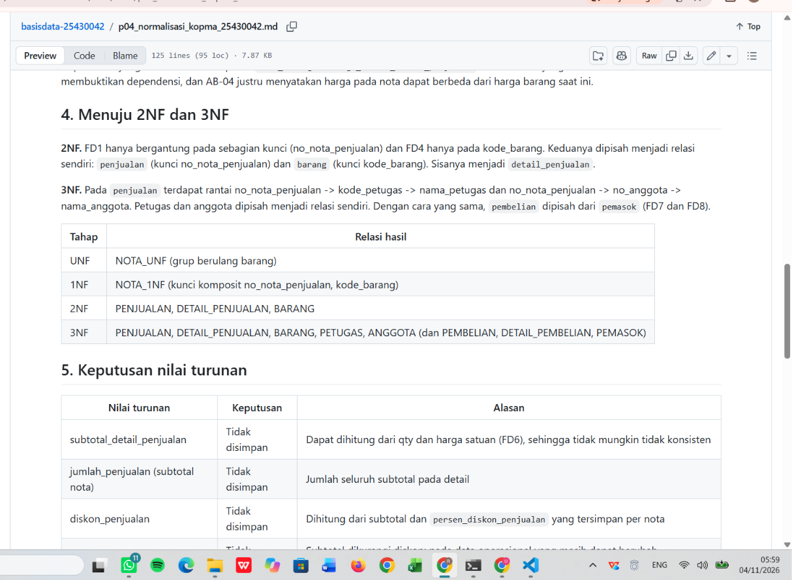
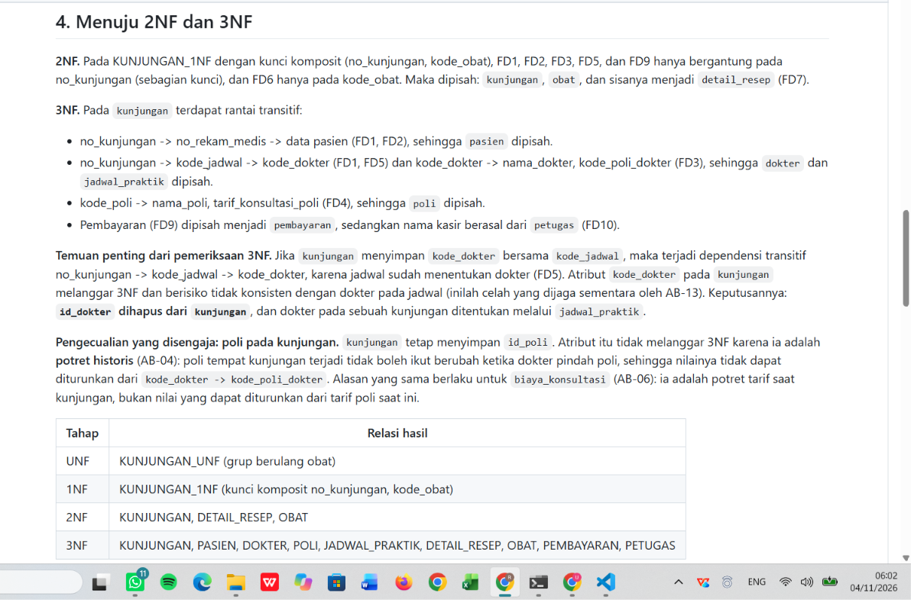
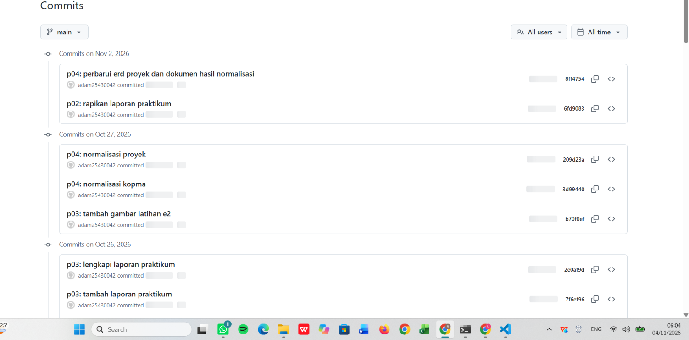

# Laporan Praktikum Basis Data - Pertemuan 04

- **Nama:** ADAM MAULANA FIRMANSYAH
- **NIM:** 25430042
- **Kelas:** B
- **Tanggal:** <isi tanggal pelaksanaan praktikum Pertemuan 4>
- **Asisten/Dosen:** Dedi Irawan, S.Kom., M.T.I.

## 1. Tujuan Praktikum

Saya dapat mengenali anomali ubah, sisip, dan hapus pada tabel yang belum dinormalisasi. Saya dapat menurunkan dependensi fungsional dari aturan bisnis, lalu memecah relasi dari UNF sampai 1NF, 2NF, dan 3NF serta memeriksanya terhadap BCNF. Saya dapat memutuskan nilai turunan yang disimpan atau dihitung beserta alasannya, dan memperbarui ERD bila hasil normalisasi mengubahnya. Hasilnya saya catat dalam dokumen Markdown di Git yang tersambung ke GitHub.

## 2. Ringkasan Dasar Teori

Normalisasi memecah tabel agar setiap fakta tersimpan di satu tempat. Tabel yang belum dinormalisasi menimbulkan tiga anomali: **ubah** (satu fakta tertulis di banyak baris dan bisa tidak konsisten), **sisip** (data tidak dapat dicatat sebelum data lain ada), dan **hapus** (menghapus satu baris ikut menghapus fakta lain).

**UNF** masih memuat grup berulang, **1NF** membuat setiap sel atomik dengan kunci yang jelas, **2NF** menghilangkan atribut yang hanya bergantung pada sebagian kunci komposit, dan **3NF** menghilangkan dependensi transitif. **BCNF** menuntut setiap penentu dalam sebuah relasi adalah kunci kandidat. **Dependensi fungsional** (FD) harus diturunkan dari aturan bisnis, bukan dari contoh data, karena contoh data hanya dapat membantah sebuah dependensi dan tidak dapat membuktikannya. Kunci pengganti `id_*` tidak menghapus dependensi fungsional, sehingga pemeriksaan tetap memakai kunci alami. Nilai turunan dapat dihitung dari atribut lain: data operasional yang masih berubah sebaiknya dihitung, sedangkan potret historis yang tidak boleh berubah disimpan.

## 3. Hasil Langkah Percobaan

### 3.1 Spreadsheet lama dan tiga anomali

Spreadsheet lama Kopma menyimpan nota, anggota, dan barang dalam satu tabel. Pada contoh data, anggota A-0457 tertulis "Rina Amelia" dan "Rina A." (anomali ubah), mahasiswa yang baru mendaftar tidak dapat dicatat sebelum belanja (anomali sisip), dan menghapus satu-satunya nota seorang anggota ikut menghapus data anggota itu (anomali hapus).

### 3.2 Dari UNF ke 1NF

Relasi `NOTA_UNF` memuat grup berulang barang. Grup itu dihilangkan sehingga setiap barang pada setiap nota menjadi satu baris, dan kunci primernya menjadi komposit (`no_nota_penjualan`, `kode_barang`) pada `NOTA_1NF`.

### 3.3 Dependensi fungsional Kopma

Saya menulis sepuluh dependensi (FD1 sampai FD9, termasuk FD3b) dengan dasar aturan bisnis, misalnya FD1 dari AB-01, AB-11, dan AB-13, FD3 dari AB-05, dan FD5 dari AB-04. Satu dependensi yang salah, `kode_barang -> harga_satuan_detail_penjualan`, tidak dipakai karena AB-04 menyatakan harga pada nota dapat berbeda dari harga barang saat ini.

### 3.4 Tahapan menuju 3NF dan BCNF

Pada 2NF, atribut tingkat nota dan tingkat barang dipisah menjadi `penjualan` dan `barang`, sehingga `detail_penjualan` tersisa. Pada 3NF, petugas dan anggota dipisah dari `penjualan` (rantai `no_nota_penjualan -> kode_petugas -> nama_petugas` dan `no_nota_penjualan -> no_anggota -> nama_anggota`), dan pembelian dipisah dari pemasok. Pada pemeriksaan BCNF, setiap penentu pada kedelapan tabel merupakan kunci kandidat.



Gambar 1. Tabel tahapan UNF, 1NF, 2NF, dan 3NF pada dokumen normalisasi Kopma.

### 3.5 Keputusan nilai turunan Kopma

Subtotal detail, jumlah penjualan, diskon, total, potongan poin, dan saldo poin **tidak disimpan** karena dapat dihitung. Persentase diskon (`persen_diskon_penjualan`) **disimpan per nota** karena bukan nilai turunan: aturan diskon dapat berubah, sedangkan nota lama harus tetap sama (AB-13).

### 3.6 Skema akhir dan perbandingan dengan skema kanonik

Skema akhir Kopma memiliki delapan tabel (`petugas`, `anggota`, `barang`, `pemasok`, `penjualan`, `detail_penjualan`, `pembelian`, `detail_pembelian`) dengan `id_*` sebagai kunci primer dan kode alami sebagai kunci unik. Perbedaan dengan skema kanonik buku: saya menambah `persen_diskon_penjualan`, `poin_didapat`, dan `poin_ditukar` pada `penjualan`, serta `id_petugas` pada `pembelian` (AB-12).

## 4. Jawaban Titik Analisis

### Titik Analisis 1

FD5 menempatkan `harga_satuan_detail_penjualan` pada kunci (`no_nota_penjualan`, `kode_barang`) karena harga adalah potret pada satu baris nota: nilainya ditentukan oleh nota dan barang bersama-sama (AB-04), bukan oleh barang saja. Jika harga dipindah ke tabel `barang`, setiap barang hanya punya satu harga. Ketika harga naik, nilai itu berubah untuk seluruh nota lama, sehingga laporan omzet tahun lalu dihitung ulang dengan harga hari ini dan tidak cocok lagi dengan uang yang pernah diterima.

### Titik Analisis 2

Kedua keputusan itu konsisten karena membedakan data operasional dari potret historis. Pada tabel operasional `penjualan`, total masih dapat berubah (koreksi qty, harga, atau diskon) sehingga lebih aman dihitung, karena nilai yang tersimpan bisa tidak cocok dengan komponennya. Pada tabel arsip, total disimpan karena sudah menjadi potret historis yang tidak boleh berubah walaupun harga atau aturan diskon di masa depan berubah. Prinsipnya sama: simpan yang tidak boleh berubah, hitung yang masih dapat diturunkan. Pola yang sama saya pakai pada proyek klinik, yaitu `pembayaran.jumlah_dibayar` menyimpan total sebagai potret historis, sedangkan total biaya kunjungan dihitung.

### Titik Analisis 3

Informasi "barang ini dipasok oleh siapa" kini tersimpan lewat `detail_pembelian`, yang menghubungkan `barang` ke `pembelian`, dan `pembelian` menyimpan `id_pemasok`. Keuntungannya dibanding satu nama pemasok di tabel `barang`: satu barang dapat dipasok beberapa pemasok dari waktu ke waktu tanpa kehilangan riwayat (pemasok mana, kapan, dan pada harga beli berapa). Satu nama di `barang` juga akan tertimpa saat pemasok berganti, dan perubahan nama pemasok harus diubah di setiap baris barang yang dipasoknya (anomali ubah).

## 5. Hasil Latihan dan Modifikasi

### E.1 Beberapa nomor telepon per pemasok

Jika kolom `telepon_pemasok` pada `pemasok` memuat beberapa nomor dalam satu sel, kolom itu melanggar 1NF karena tidak atomik. Saya memecahnya menjadi relasi baru dan menghapus `telepon_pemasok` dari `pemasok`.

| Tabel | Kunci primer | Kunci tamu | Atribut lain |
|---|---|---|---|
| telepon_pemasok | (id_pemasok, no_telepon_pemasok) | id_pemasok | jenis_telepon_pemasok |

Dependensi barunya: (`id_pemasok`, `no_telepon_pemasok`) -> `jenis_telepon_pemasok` (misalnya kantor atau WhatsApp). Penentunya adalah kunci primer, sehingga relasi ini memenuhi BCNF. Satu pemasok dapat memiliki nol atau banyak nomor telepon, dan satu nomor milik tepat satu pemasok.

### E.2 Contoh pelanggaran 3NF dan anomali ubah

Jika `nama_anggota` disimpan langsung di tabel `penjualan`, terjadi dependensi transitif `no_nota_penjualan -> no_anggota -> nama_anggota`.

| no_nota_penjualan | no_anggota | nama_anggota |
|---|---|---|
| PJ-2609-0141 | A-0457 | Rina Amelia |
| PJ-2609-0198 | A-0457 | Rina Amelia |
| PJ-2609-0231 | A-0312 | Dimas Pratama |

Kueri berikut memperbaiki nama hanya pada satu nota:

```sql
UPDATE penjualan
SET nama_anggota = 'Rina Amelia Putri'
WHERE no_nota_penjualan = 'PJ-2609-0141';
```

Hasilnya, nota PJ-2609-0141 memuat "Rina Amelia Putri", sedangkan PJ-2609-0198 masih "Rina Amelia". Anggota A-0457 kini memiliki dua nama, dan itu adalah anomali ubah. Jika `nama_anggota` hanya ada di tabel `anggota`, satu kueri `UPDATE` pada satu baris memperbaiki nama di semua nota. Contoh ini hanya ilustrasi, karena tabelnya baru dibuat pada Pertemuan 5.

## 6. Tugas Mandiri: Milestone Proyek 4

- **Organisasi fiktif:** Bunda_AMF
- **Tema:** Klinik
- **Berkas:** `p04_normalisasi_25430042.md`
- **Dokumen sumber:** Lembar Kunjungan Pasien (Pertemuan 2)

### 6.1 Ringkasan hasil

| Komponen | Hasil |
|---|---|
| Dependensi fungsional | 11 (FD1 sampai FD10, termasuk FD9b), semuanya berkode AB atau definisi entitas |
| Tahapan | UNF (grup berulang obat), 1NF (kunci komposit no_kunjungan, kode_obat), 2NF (kunjungan, detail_resep, obat), 3NF (sembilan tabel) |
| BCNF | Seluruh sembilan tabel memenuhi BCNF |
| Skema akhir | poli, dokter, jadwal_praktik, pasien, petugas, kunjungan, obat, detail_resep, pembayaran |



Gambar 2. Tabel tahapan UNF, 1NF, 2NF, dan 3NF pada dokumen normalisasi proyek klinik.

### 6.2 Temuan penting: dependensi transitif pada kunjungan

Pemeriksaan 3NF menemukan bahwa `kunjungan` yang menyimpan `id_dokter` bersama `id_jadwal` memiliki dependensi transitif `no_kunjungan -> id_jadwal -> id_dokter`, karena jadwal praktik sudah menentukan dokter (FD5). Redundansi ini sudah saya catat sebagai isu yang diketahui pada Pertemuan 3. Keputusannya: `id_dokter` dihapus dari `kunjungan`, dan dokter pada sebuah kunjungan ditentukan melalui `jadwal_praktik`.

### 6.3 Pengecualian yang disengaja

`id_poli` dan `biaya_konsultasi` tetap disimpan pada `kunjungan` karena keduanya potret historis (AB-04 dan AB-06), bukan nilai turunan: poli dan tarif saat kunjungan tidak boleh ikut berubah ketika dokter pindah poli atau tarif poli naik, sehingga tidak melanggar 3NF.

### 6.4 Keputusan nilai turunan klinik

`usia_pasien`, `subtotal_obat`, `total_biaya_obat`, `diskon_konsultasi`, dan `total_biaya_kunjungan` tidak disimpan pada tabel operasional. Potret historis pembayaran disimpan sebagai `jumlah_dibayar` pada `pembayaran` (AB-11).

### 6.5 Perubahan ERD dan dokumen

| Perubahan | Dokumen yang ikut diperbarui |
|---|---|
| Hapus `id_dokter` dari `kunjungan` dan relasi dokter menangani kunjungan | AB-01, AB-13, penelusuran KI-03 dan KI-04, serta gambar ERD (`p03_erd_25430042.drawio` dan `.png`) |

Perubahan ini tercatat pada commit `8ff4754`.

## 7. Pembahasan dan Kendala

**Kendala 1: versi berkas unduhan tertukar.** Berkas ERD di folder `Downloads` berukuran 36.094 byte, yaitu versi lama, sedangkan versi baru berukuran 34.706 byte. Saya membedakan keduanya lewat ukuran dan hitungan relasi di dalam berkas (`edge=.1.` bernilai 10 pada versi baru), lalu memindahkan versi lama dan mengunduh ulang.

**Kendala 2: berkas salah tempat.** Laporan dan gambar hasil ekspor sempat tersimpan di folder yang tidak sesuai (folder utama dan `laporan/img/`). `git status` memperlihatkan berkas `??` yang tidak diharapkan, lalu saya memindahkannya dengan perintah `move` ke tempat yang benar.

**Kendala 3: folder pribadi hampir ter-commit.** `git status` menampilkan folder `Adam/` berisi dokumen pribadi. Saya tidak menjalankan `git add` pada folder itu dan memindahkannya ke luar folder proyek, karena repositori bersifat publik.

**Kendala 4: koma ganda setelah penggantian teks.** Penggantian teks di dokumen klinik menyisakan `,,` pada baris entitas Kunjungan. Saya mencarinya dengan `findstr /c:",,"` dan memperbaikinya, lalu memastikan hasilnya kosong.

## 8. Kesimpulan

Praktikum Pertemuan 4 mengajarkan saya menormalisasi tabel dari UNF sampai 3NF dengan dependensi yang diturunkan dari aturan bisnis. Saya memahami bahwa kunci pengganti tidak menghapus dependensi, bahwa potret historis seperti harga dan total pembayaran perlu disimpan sedangkan nilai turunan operasional dihitung, dan bahwa hasil normalisasi dapat mengubah ERD, seperti dihapusnya `id_dokter` dari `kunjungan`. Seluruh hasil tercatat di GitHub dengan commit berformat `p04:`.

## 9. Pernyataan Penggunaan AI

Saya menggunakan AI sebagai alat bantu untuk memahami konsep normalisasi dan dependensi fungsional, membantu menyusun draf dokumen normalisasi Kopma dan proyek, membantu memeriksa pertentangan antar-dokumen, serta membantu memperbaiki kesalahan perintah Git dan berkas. Bantuan ini saya gunakan dengan izin dosen yang saya konfirmasi saat pembelajaran. Hasilnya saya baca, saya periksa, dan saya pelajari sehingga saya dapat menjelaskan setiap dependensi dan keputusan nilai turunan dari aturan bisnisnya.

## 10. Bukti Git

- Repositori: `https://github.com/adam25430042/basisdata-25430042`
- Commit normalisasi Kopma: `3d99440` (`p04: normalisasi kopma`)
- Commit normalisasi proyek: `209d23a` (`p04: normalisasi proyek`)
- Commit rapikan laporan Pertemuan 2: `6fd9083` (`p02: rapikan laporan praktikum`)
- Commit ERD dan dokumen hasil normalisasi: `8ff4754` (`p04: perbarui erd proyek dan dokumen hasil normalisasi`)
- Commit laporan: `<isi 7 karakter hash setelah commit laporan>`



Gambar 3. Riwayat commit Pertemuan 4 di GitHub.

## Checklist

- [x] Berkas wajib: p04_normalisasi_25430042.md (proyek) dan p04_normalisasi_kopma_25430042.md
- [ ] Bukti tangkapan layar: tabel tahapan UNF, 1NF, 2NF, dan 3NF
- [x] Analisis wajib: daftar dependensi fungsional; keputusan menyimpan atau menghitung nilai turunan beserta alasannya
